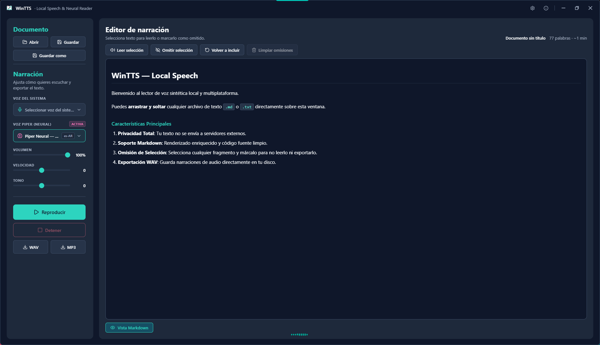
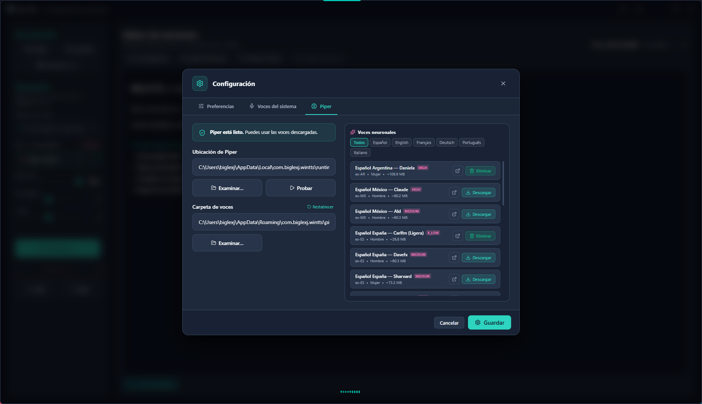
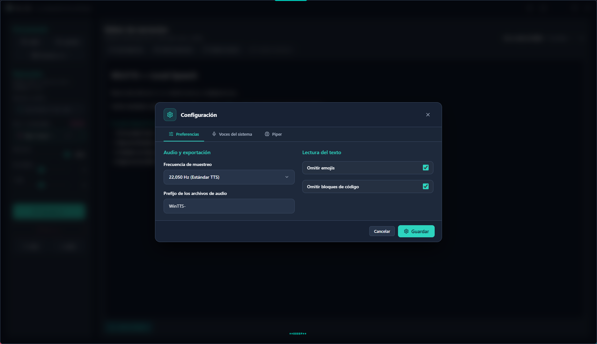

# 🎙️ WinTTS v2.0.0 (Nougat & Nugget Update) — Local Speech & Neural Reader

WinTTS es una aplicación de escritorio nativa y multiplataforma construida con **Rust + Tauri 2.0**, **React 19**, **TypeScript** y **Vite**, diseñada para la síntesis de texto a voz (TTS) de forma 100% local, privada y de alto rendimiento.

Cuenta con un motor de limpieza inteligente que preprocesa sintaxis Markdown (negritas, enlaces, listas, títulos, código y comentarios HTML), omisión de emojis y exclusión dinámica de fragmentos en ámbar antes de iniciar la lectura o exportación de audio.

---

## 📸 Interfaz y Diseño

Con una estética oscura inspirada en el lenguaje de diseño de **Aurora**, la aplicación cuenta con una paleta Dark Slate/Teal (`#0F172A`, `#1E293B`, `#2DD4BF`), controles vectoriales de ventana sin marco y un área de trabajo espaciosa y enfocada.

<div align="center">
  
</div>

<br/>

<div align="center">
  
  &nbsp;
  
</div>

---

## ✨ Características Principales

* **Abrir y Guardar Documentos**: `Ctrl+O` abre `.md` y `.txt`, `Ctrl+S` guarda y `Ctrl+Shift+S` guarda con otro nombre. El borrador en edición se restaura al reabrir la aplicación.
* **Arrastrar y Soltar Inteligente (Drag & Drop)**: Inserta instantáneamente archivos `.md` y `.txt` soltándolos sobre la ventana con un overlay visual elegante.
* **Multiplataforma y Ligero**: Desarrollado sobre **Rust + Tauri 2.0**, con consumo mínimo de RAM y arranque instantáneo.
* **Voces Locales y Neuronales**: Voces nativas del sistema y, si quieres, catálogo de voces neuronales **Piper TTS**. El motor se instala desde la propia aplicación (binario oficial verificado por hash) y la sección de voz neural solo aparece cuando está operativo.
* **Vista Markdown Dual**: Alterna con un clic entre la previsualización renderizada y el código fuente con editor en tiempo real.
* **Selección y Marcado de Omisiones**: Selecciona fragmentos de texto y márcalos como omitidos (resaltado en ámbar) para excluirlos de la narración y de la exportación. Las marcas se reajustan solas si editas el documento.
* **Control Integral de Lectura**: Reproducir, pausar, reanudar, detener, ajustar volumen (0-100%), velocidad (-10 a +10) y tono (-10 a +10).
* **Exportación WAV y MP3 de Alta Fidelidad**: Genera archivos de audio locales listos para compartir o usar en producción offline. El idioma del audio exportado sigue a la voz que elegiste.
* **Atajos de Teclado**:
  - `Ctrl + Enter`: Reproducir / Pausar
  - `Ctrl + O`: Abrir documento
  - `Ctrl + S`: Guardar documento
  - `Ctrl + Shift + S`: Guardar como
  - `Esc`: Detener lectura

---

## 🧠 Motor de Voces Neuronales (Piper)

Las voces neuronales son **reales**, no decorativas. Y son **opcionales**: WinTTS
funciona entero con las voces del sistema, así que el motor solo aparece cuando
lo instalas.

1. Abre *Ajustes → Motor Piper TTS* y pulsa **Instalar Piper**: la aplicación
   descarga el binario oficial (22 MB), comprueba su hash y lo deja instalado en
   su carpeta de datos, rellenando sola la ruta. También puedes apuntar a un
   `piper.exe` que ya tengas con **Examinar…**.
2. Con el motor instalado se descarga la voz por defecto; el resto del catálogo
   de voces neuronales está a un clic, con los pesos `.onnx` tomados de
   Hugging Face (el catálogo se contrastó contra el repositorio real).
3. Elige la voz en la barra lateral: WinTTS sintetiza el texto con Piper y
   reproduce el WAV generado.

Mientras el motor no está instalado, la sección de voz neural **no se muestra**
en la barra lateral: no hay avisos ni avisos de que algo falte, porque no falta
nada. En cuanto el motor aparece, la sección se suma sola.

---

## 🚀 Cómo Empezar

### Requisitos
* **Node.js**: v20+ o v24+
* **Rust**: `cargo` y `rustc` (edición 2021 o superior)

### Operación con Mise (Estándar Ecosistema)

WinTTS implementa la interfaz universal de tareas mediante Mise:

| Tarea | Propósito |
|---|---|
| `mise dev` | Ejecutar en modo desarrollo (`tauri:dev`). |
| `mise build` | Compilar frontend y binario de escritorio sin generar instaladores. |
| `mise release` | Generar instalador oficial Inno Setup (`.exe`) y paquete Microsoft Store (`.msix`) en `release/` sin publicar. |
| `mise publish` | Publicar en GitHub Releases (instalador `.exe` + paquete `.msix` + `SHA256SUMS.txt`) y sincronizar ficha en Aurora (`--plan` y `--check` sin escritura). |

Opciones de inspección y comprobación:
- `--plan`: Muestra el comando y las operaciones planificadas sin ejecutar procesos ni modificar el sistema (`mise dev --plan`, `mise release --plan`, `mise publish --plan`).
- `--check`: (para `publish`) Verifica el estado del repositorio, tags, notas y la presencia e integridad del instalador en `release/` sin publicar nada (`mise publish --check`).
- Canal explícito `github`: `mise publish github` (omite la sincronización con la web de Aurora).

### Flujos directos auxiliares

```bash
# Iniciar en modo desarrollo
bun run tauri dev

# Compilar frontend y binario nativo (sin instalador)
bun run build:web && bun run tauri build --no-bundle

# Generar instalador oficial de Windows (Inno Setup)
powershell -ExecutionPolicy Bypass -File .\scripts\packaging\Build-Installer.ps1
```

---

## 🛠️ Tecnologías y Arquitectura

* **Backend**: Rust 1.97+, Tauri 2.0, Regex, Hound WAV, Windows SpeechSynthesis / Cross-platform APIs.
* **Frontend**: React 19, TypeScript, Vite 6, Vanilla CSS con variables semánticas, Lucide Icons.
* **Código Legacy**: Versionado histórico conservado en `archivado/`.

---

## ⚖️ Licencia y Autor

Distribuido bajo la **Licencia MIT**.

Creado con precisión científica y cariño por **[@biglexj](https://github.com/biglexj)** (2026).
* Donaciones y soporte: [Buy Me a Coffee](https://buymeacoffee.com/biglexj) · [Donaciones Oficiales](https://www.biglexj.com/donaciones)
